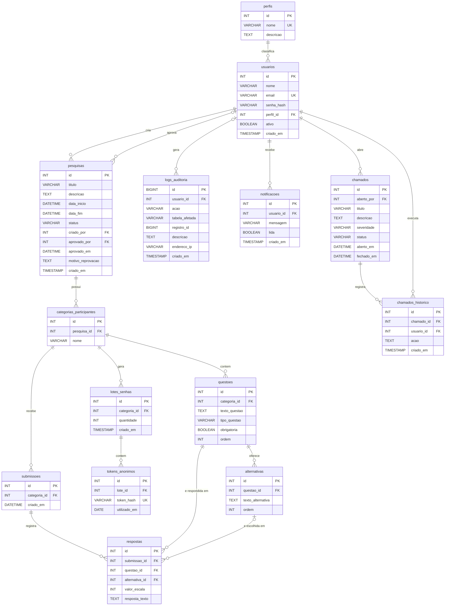

# MER — Sistema de Gestão de Pesquisas por Questionários (modelo físico)

> Modelo físico · Notação IE · Gerado a partir de `script_banco_gestao_pesquisas.sql` · MySQL 8.0.16+ / MariaDB 10.5+

## Sumário

- [Diagrama (Mermaid)](#diagrama-mermaid)
- [Entidades](#entidades)
  - Usuários e perfis: [perfis](#perfis) · [usuarios](#usuarios)
  - Pesquisas e questionário: [pesquisas](#pesquisas) · [categorias_participantes](#categorias_participantes) · [questoes](#questoes) · [alternativas](#alternativas)
  - Senhas anônimas: [lotes_senhas](#lotes_senhas) · [tokens_anonimos](#tokens_anonimos)
  - Respostas: [submissoes](#submissoes) · [respostas](#respostas)
  - Auditoria e notificações: [logs_auditoria](#logs_auditoria) · [notificacoes](#notificacoes)
  - Suporte técnico: [chamados](#chamados) · [chamados_historico](#chamados_historico)
- [Relacionamentos](#relacionamentos)
- [Restrições CHECK e UNIQUE](#restrições-check-e-unique)
- [Índices](#índices)
- [Triggers (regras no banco)](#triggers-regras-no-banco)
- [Regras mantidas pela aplicação](#regras-mantidas-pela-aplicação)
- [Legenda](#legenda)

---

## Diagrama (Mermaid)

> Os tamanhos dos tipos (ex.: `VARCHAR(100)`) estão nas tabelas de cada entidade; no diagrama aparecem só os tipos base, para manter compatibilidade com o Mermaid.
> Não existe ligação entre `tokens_anonimos` e `submissoes`/`respostas`: isso preserva o anonimato dos participantes.

---

## Entidades

### perfis

| Atributo | Tipo | Chave | Obrigatório | Observação |
|---|---|---|---|---|
| id | INT AUTO_INCREMENT | PK | Sim | |
| nome | VARCHAR(50) | UK | Sim | Único (`uq_perfis_nome`) |
| descricao | TEXT | | Não | |

Perfis iniciais: Administrador, Secretaria, Analista de Dados, Suporte Técnico e Auditor.

### usuarios

| Atributo | Tipo | Chave | Obrigatório | Observação |
|---|---|---|---|---|
| id | INT AUTO_INCREMENT | PK | Sim | |
| nome | VARCHAR(100) | | Sim | |
| email | VARCHAR(100) | UK | Sim | Único (`uq_usuarios_email`) |
| senha_hash | VARCHAR(255) | | Sim | BCrypt/Argon2, nunca texto puro |
| perfil_id | INT | FK → perfis | Sim | |
| ativo | BOOLEAN | | Sim | Padrão `TRUE`; `FALSE` = desativado (permissões revogadas) |
| criado_em | TIMESTAMP | | Sim | Padrão `CURRENT_TIMESTAMP` |

### pesquisas

| Atributo | Tipo | Chave | Obrigatório | Observação |
|---|---|---|---|---|
| id | INT AUTO_INCREMENT | PK | Sim | |
| titulo | VARCHAR(100) | | Sim | Entre 5 e 100 caracteres |
| descricao | TEXT | | Não | |
| data_inicio | DATETIME | | Sim | |
| data_fim | DATETIME | | Sim | Deve ser maior que `data_inicio` |
| status | VARCHAR(20) | | Sim | Padrão `RASCUNHO` |
| criado_por | INT | FK → usuarios | Sim | |
| aprovado_por | INT | FK → usuarios | Não | Preenchido pela Secretaria |
| aprovado_em | DATETIME | | Não | |
| motivo_reprovacao | TEXT | | Não | |
| criado_em | TIMESTAMP | | Sim | Padrão `CURRENT_TIMESTAMP` |

### categorias_participantes

| Atributo | Tipo | Chave | Obrigatório | Observação |
|---|---|---|---|---|
| id | INT AUTO_INCREMENT | PK | Sim | |
| pesquisa_id | INT | FK → pesquisas | Sim | |
| nome | VARCHAR(50) | | Sim | Único dentro da pesquisa (`pesquisa_id`, `nome`) |

### questoes

| Atributo | Tipo | Chave | Obrigatório | Observação |
|---|---|---|---|---|
| id | INT AUTO_INCREMENT | PK | Sim | |
| categoria_id | INT | FK → categorias_participantes | Sim | |
| texto_questao | TEXT | | Sim | |
| tipo_questao | VARCHAR(30) | | Sim | `MULTIPLA_UNICA`, `MULTIPLA_VARIAS`, `ESCALA` ou `ABERTA` |
| obrigatoria | BOOLEAN | | Sim | Padrão `FALSE` |
| ordem | INT | | Sim | Padrão 1; mínimo 1 |

### alternativas

| Atributo | Tipo | Chave | Obrigatório | Observação |
|---|---|---|---|---|
| id | INT AUTO_INCREMENT | PK | Sim | |
| questao_id | INT | FK → questoes | Sim | |
| texto_alternativa | TEXT | | Sim | |
| ordem | INT | | Sim | Padrão 1; mínimo 1 |

`UNIQUE (id, questao_id)` existe para permitir a FK composta usada em `respostas`.

### lotes_senhas

| Atributo | Tipo | Chave | Obrigatório | Observação |
|---|---|---|---|---|
| id | INT AUTO_INCREMENT | PK | Sim | |
| categoria_id | INT | FK → categorias_participantes | Sim | |
| quantidade | INT | | Sim | Maior que 0 |
| criado_em | TIMESTAMP | | Sim | Padrão `CURRENT_TIMESTAMP` |

### tokens_anonimos

| Atributo | Tipo | Chave | Obrigatório | Observação |
|---|---|---|---|---|
| id | INT AUTO_INCREMENT | PK | Sim | |
| lote_id | INT | FK → lotes_senhas | Sim | |
| token_hash | VARCHAR(64) | UK | Sim | SHA-256 em hexadecimal; a senha em texto nunca é gravada |
| utilizado_em | DATE | | Não | `NULL` = disponível; guarda só a data (sem hora) por causa do anonimato |

### submissoes

| Atributo | Tipo | Chave | Obrigatório | Observação |
|---|---|---|---|---|
| id | INT AUTO_INCREMENT | PK | Sim | |
| categoria_id | INT | FK → categorias_participantes | Sim | |
| criado_em | DATETIME | | Sim | Padrão `CURRENT_TIMESTAMP` |

Sem nenhuma ligação com `tokens_anonimos`, para preservar o anonimato.

### respostas

| Atributo | Tipo | Chave | Obrigatório | Observação |
|---|---|---|---|---|
| id | INT AUTO_INCREMENT | PK | Sim | |
| submissao_id | INT | FK → submissoes | Sim | |
| questao_id | INT | FK → questoes | Sim | |
| alternativa_id | INT | FK → alternativas (composta) | Não | Só em questões de múltipla escolha |
| valor_escala | INT | | Não | Só em questões de escala (1 a 5) |
| resposta_texto | TEXT | | Não | Só em questões abertas |

FK composta (`alternativa_id`, `questao_id`) → `alternativas` (`id`, `questao_id`): a alternativa escolhida precisa pertencer à questão respondida. Quando `alternativa_id` é `NULL`, a verificação é ignorada.

### logs_auditoria

| Atributo | Tipo | Chave | Obrigatório | Observação |
|---|---|---|---|---|
| id | BIGINT AUTO_INCREMENT | PK | Sim | |
| usuario_id | INT | FK → usuarios | Não | `NULL` = ação do sistema |
| acao | VARCHAR(100) | | Sim | |
| tabela_afetada | VARCHAR(50) | | Não | |
| registro_id | BIGINT | | Não | |
| descricao | TEXT | | Não | |
| endereco_ip | VARCHAR(45) | | Não | Apenas de usuários internos, nunca de participantes |
| criado_em | TIMESTAMP | | Sim | Padrão `CURRENT_TIMESTAMP` |

### notificacoes

| Atributo | Tipo | Chave | Obrigatório | Observação |
|---|---|---|---|---|
| id | INT AUTO_INCREMENT | PK | Sim | |
| usuario_id | INT | FK → usuarios | Sim | Destinatário |
| mensagem | VARCHAR(255) | | Sim | |
| lida | BOOLEAN | | Sim | Padrão `FALSE` |
| criado_em | TIMESTAMP | | Sim | Padrão `CURRENT_TIMESTAMP` |

### chamados

| Atributo | Tipo | Chave | Obrigatório | Observação |
|---|---|---|---|---|
| id | INT AUTO_INCREMENT | PK | Sim | |
| aberto_por | INT | FK → usuarios | Sim | |
| titulo | VARCHAR(100) | | Sim | |
| descricao | TEXT | | Não | |
| severidade | VARCHAR(20) | | Sim | `CRITICA`, `MEDIA` ou `BAIXA` |
| status | VARCHAR(20) | | Sim | Padrão `ABERTO`; `ABERTO` ou `FECHADO` |
| aberto_em | DATETIME | | Sim | Padrão `CURRENT_TIMESTAMP` |
| fechado_em | DATETIME | | Não | |

### chamados_historico

| Atributo | Tipo | Chave | Obrigatório | Observação |
|---|---|---|---|---|
| id | INT AUTO_INCREMENT | PK | Sim | |
| chamado_id | INT | FK → chamados | Sim | |
| usuario_id | INT | FK → usuarios | Sim | |
| acao | TEXT | | Sim | |
| criado_em | TIMESTAMP | | Sim | Padrão `CURRENT_TIMESTAMP` |

---

## Relacionamentos

Todas as FKs usam `ON DELETE RESTRICT ON UPDATE RESTRICT`.

| Lado "um" | Cardinalidade | Lado "muitos" / dependente | FK |
|---|---|---|---|
| perfis | 1 : 0..N | usuarios | usuarios.perfil_id |
| usuarios | 1 : 0..N | pesquisas | pesquisas.criado_por |
| usuarios | 0..1 : 0..N | pesquisas | pesquisas.aprovado_por (opcional) |
| pesquisas | 1 : 0..N | categorias_participantes | categorias_participantes.pesquisa_id |
| categorias_participantes | 1 : 0..N | questoes | questoes.categoria_id |
| questoes | 1 : 0..N | alternativas | alternativas.questao_id |
| categorias_participantes | 1 : 0..N | lotes_senhas | lotes_senhas.categoria_id |
| lotes_senhas | 1 : 0..N | tokens_anonimos | tokens_anonimos.lote_id |
| categorias_participantes | 1 : 0..N | submissoes | submissoes.categoria_id |
| submissoes | 1 : 0..N | respostas | respostas.submissao_id |
| questoes | 1 : 0..N | respostas | respostas.questao_id |
| alternativas | 0..1 : 0..N | respostas | respostas.(alternativa_id, questao_id) (opcional, FK composta) |
| usuarios | 0..1 : 0..N | logs_auditoria | logs_auditoria.usuario_id (opcional) |
| usuarios | 1 : 0..N | notificacoes | notificacoes.usuario_id |
| usuarios | 1 : 0..N | chamados | chamados.aberto_por |
| chamados | 1 : 0..N | chamados_historico | chamados_historico.chamado_id |
| usuarios | 1 : 0..N | chamados_historico | chamados_historico.usuario_id |

---

## Restrições CHECK e UNIQUE

| Tabela | Restrição | Regra |
|---|---|---|
| perfis | uq_perfis_nome | `nome` único |
| usuarios | uq_usuarios_email | `email` único |
| pesquisas | ck_pesquisas_titulo | `CHAR_LENGTH(titulo)` entre 5 e 100 |
| pesquisas | ck_pesquisas_periodo | `data_fim > data_inicio` |
| pesquisas | ck_pesquisas_status | `RASCUNHO`, `EM_ANALISE`, `APROVADA`, `REPROVADA`, `ATIVA` ou `ENCERRADA` |
| categorias_participantes | uq_categorias_pesquisa_nome | (`pesquisa_id`, `nome`) único |
| questoes | ck_questoes_tipo | `MULTIPLA_UNICA`, `MULTIPLA_VARIAS`, `ESCALA` ou `ABERTA` |
| questoes | ck_questoes_ordem | `ordem >= 1` |
| alternativas | uq_alternativas_id_questao | (`id`, `questao_id`) único — base da FK composta |
| alternativas | ck_alternativas_ordem | `ordem >= 1` |
| lotes_senhas | ck_lotes_quantidade | `quantidade > 0` |
| tokens_anonimos | uq_tokens_hash | `token_hash` único |
| respostas | ck_respostas_escala | `valor_escala` nulo ou entre 1 e 5 |
| chamados | ck_chamados_severidade | `CRITICA`, `MEDIA` ou `BAIXA` |
| chamados | ck_chamados_status | `ABERTO` ou `FECHADO` |

---

## Índices

| Índice | Tabela | Colunas |
|---|---|---|
| idx_pesquisas_status | pesquisas | status |
| idx_pesquisas_periodo | pesquisas | data_inicio, data_fim |
| idx_submissoes_criado_em | submissoes | criado_em |
| idx_logs_criado_em | logs_auditoria | criado_em |

---

## Triggers (regras no banco)

| Trigger | Tabela | Evento | Regra |
|---|---|---|---|
| trg_logs_bloqueia_update | logs_auditoria | BEFORE UPDATE | Bloqueia qualquer alteração: logs são imutáveis (RNF29) |
| trg_logs_bloqueia_delete | logs_auditoria | BEFORE DELETE | Bloqueia qualquer exclusão: logs são imutáveis (RNF29) |
| trg_tokens_uma_utilizacao | tokens_anonimos | BEFORE UPDATE | Impede alterar uma senha já utilizada (RF09) e impede mudar `token_hash` e `lote_id` |
| trg_respostas_mesma_categoria | respostas | BEFORE INSERT | A questão respondida deve ser da mesma categoria da submissão |

---

## Regras mantidas pela aplicação

Não são possíveis só com o banco:

- Uma pesquisa precisa de ao menos 1 categoria com questionário para ir a `EM_ANALISE`.
- Gerar lote somente para pesquisa `APROVADA`; gerar os tokens e o lote na mesma transação.
- Gravar submissão, respostas e marcar a senha como utilizada na mesma transação.
- Respostas obrigatórias e tipo de resposta compatível com o tipo da questão.

---

## Legenda

Notação IE (Information Engineering):

| Símbolo | Mermaid | Significado |
|---|---|---|
| `‖` (dois traços) | `\|\|` | Exatamente um (FK obrigatória) |
| `○‖` (traço + círculo) | `\|o` / `o\|` | Zero ou um (FK opcional) |
| `○<` (círculo + pé de galinha) | `o{` / `}o` | Zero ou muitos |

- **PK** = chave primária · **FK** = chave estrangeira · **UK** = chave única.
