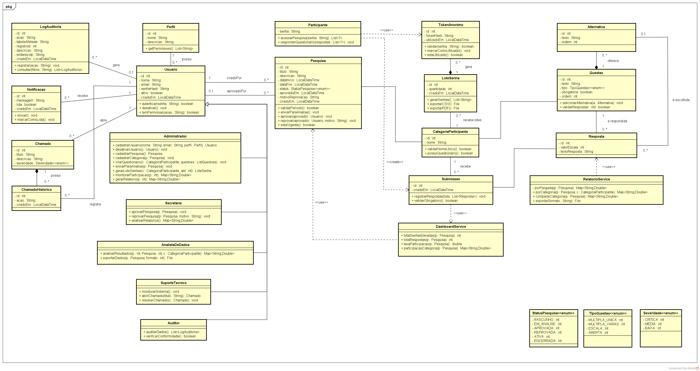

# Especificação do Diagrama de Classes — Sistema de Gestão de Pesquisas por Questionários

> Modelo de classes (UML) · Baseado no diagrama de classes (Astah) e no modelo físico (`schema.sql`)

## Sumário

- [Diagrama](#diagrama)
- [Visão geral](#visão-geral)
- [Usuários e perfis](#usuários-e-perfis): [Perfil](#perfil) · [Usuario](#usuario) · [Especializações de Usuario](#especializações-de-usuario)
- [Pesquisa e questionário](#pesquisa-e-questionário): [Pesquisa](#pesquisa) · [CategoriaParticipante](#categoriaparticipante) · [Questao](#questao) · [Alternativa](#alternativa)
- [Senhas anônimas e respostas](#senhas-anônimas-e-respostas): [LoteSenha](#lotesenha) · [TokenAnonimo](#tokenanonimo) · [Participante](#participante) · [Submissao](#submissao) · [Resposta](#resposta)
- [Auditoria e notificações](#auditoria-e-notificações): [LogAuditoria](#logauditoria) · [Notificacao](#notificacao)
- [Suporte técnico](#suporte-técnico): [Chamado](#chamado) · [ChamadoHistorico](#chamadohistorico)
- [Serviços](#serviços): [RelatorioService](#relatorioservice) · [DashboardService](#dashboardservice)
- [Enumerações](#enumerações)
- [Relacionamentos](#relacionamentos)
- [Dependências](#dependências)
- [Mapeamento classe → tabela](#mapeamento-classe--tabela)
- [Pontos de atenção](#pontos-de-atenção)

---

## Diagrama

## Visão geral

O diagrama tem **21 classes**, **3 enumerações** e uma hierarquia de especialização de `Usuario`.

| Grupo | Classes |
|---|---|
| Usuários e perfis | `Perfil`, `Usuario`, `Administrador`, `Secretaria`, `AnalistaDeDados`, `SuporteTecnico`, `Auditor` |
| Pesquisa e questionário | `Pesquisa`, `CategoriaParticipante`, `Questao`, `Alternativa` |
| Senhas anônimas e respostas | `LoteSenha`, `TokenAnonimo`, `Participante`, `Submissao`, `Resposta` |
| Auditoria e notificações | `LogAuditoria`, `Notificacao` |
| Suporte técnico | `Chamado`, `ChamadoHistorico` |
| Serviços | `RelatorioService`, `DashboardService` |

**Convenções:** `-` atributo privado · `+` método público. As classes `Participante`, `RelatorioService`, `DashboardService` e as especializações de `Usuario` não viram tabelas (ver [mapeamento](#mapeamento-classe--tabela)).

---

# Usuários e perfis

## Perfil

Papel que define as permissões de um usuário.

| Atributo | Tipo | Descrição |
|---|---|---|
| id | int | Identificador |
| nome | String | Nome do perfil (único) |
| descricao | String | Descrição das responsabilidades |

| Método | Retorno | Descrição |
|---|---|---|
| getPermissoes() | List&lt;String&gt; | Lista as ações permitidas ao perfil |

## Usuario

Usuário interno do sistema. O participante **não** é um `Usuario`.

| Atributo | Tipo | Descrição |
|---|---|---|
| id | int | Identificador |
| nome | String | Nome completo |
| email | String | E-mail (único) |
| senhaHash | String | Hash da senha (BCrypt/Argon2), nunca texto puro |
| ativo | boolean | `false` = desativado, com permissões revogadas |
| criadoEm | LocalDateTime | Data de cadastro |

| Método | Retorno | Descrição |
|---|---|---|
| autenticar(senha : String) | boolean | Valida as credenciais |
| desativar() | void | Marca `ativo = false` e revoga as permissões |
| temPermissao(acao : String) | boolean | Verifica se o perfil permite a ação |

## Especializações de Usuario

`Administrador`, `Secretaria`, `AnalistaDeDados`, `SuporteTecnico` e `Auditor` herdam de `Usuario` (generalização). Não têm atributos próprios, só métodos.

### Administrador

| Método | Retorno | Descrição |
|---|---|---|
| cadastrarUsuario(nome : String, email : String, perfil : Perfil) | Usuario | Cadastra um usuário interno (UC-ADM-06) |
| desativarUsuario(u : Usuario) | void | Desativa um usuário (UC-ADM-06) |
| cadastrarPesquisa() | Pesquisa | Cadastra uma pesquisa (UC-ADM-01) |
| cadastrarCategoria(p : Pesquisa) | void | Cadastra uma categoria de participantes (UC-ADM-02) |
| criarQuestionario(c : CategoriaParticipante, questoes : ListQuestoes) | void | Monta o questionário da categoria (UC-ADM-03) |
| enviarParaAnalise(p : Pesquisa) | void | Envia a pesquisa à Secretaria (UC-ADM-01) |
| gerarLoteSenhas(c : CategoriaParticipante, qtd : int) | LoteSenha | Gera o lote de senhas anônimas (UC-ADM-04) |
| monitorarParticipacao(p : int) | Map&lt;String,Double&gt; | Indicadores de participação (UC-ADM-07) |
| gerarRelatorio(p : int) | Map&lt;String,Double&gt; | Relatório de resultados (UC-ADM-05) |

### Secretaria

| Método | Retorno | Descrição |
|---|---|---|
| aprovarPesquisa(p : Pesquisa) | void | Aprova a pesquisa (UC-SEC-01) |
| reprovarPesquisa(p : Pesquisa, motivo : String) | void | Reprova com justificativa (UC-SEC-01) |
| analisarRelatorios() | Map&lt;String,Double&gt; | Análise de relatórios institucionais (UC-SEC-02) |

### AnalistaDeDados

| Método | Retorno | Descrição |
|---|---|---|
| analisarResultados(p : int, Pesquisa, c : CategoriaParticipante) | Map&lt;String,Double&gt; | Análise detalhada por pergunta e categoria (UC-ANA-01) |
| exportarDados(p : Pesquisa, formato : int) | File | Exporta os dados anonimizados (UC-ANA-02) |

### SuporteTecnico

| Método | Retorno | Descrição |
|---|---|---|
| monitorarSistema() | void | Monitora APIs, banco e servidores (UC-SUP-01) |
| abrirChamado(titulo : String) | Chamado | Abre um chamado de erro ou falha (UC-SUP-02) |
| resolverChamado(c : Chamado) | void | Fecha o chamado (UC-SUP-02) |

### Auditor

| Método | Retorno | Descrição |
|---|---|---|
| auditarDados() | List&lt;LogAuditoria&gt; | Consulta os logs de auditoria (UC-AUD-01) |
| verificarConformidade() | boolean | Verifica segurança e LGPD (UC-AUD-02) |

---

# Pesquisa e questionário

## Pesquisa

| Atributo | Tipo | Descrição |
|---|---|---|
| id | int | Identificador |
| titulo | String | Título (5 a 100 caracteres) |
| descricao | String | Descrição |
| dataInicio | LocalDateTime | Início do período de aplicação |
| dataFim | LocalDateTime | Fim do período (posterior ao início) |
| status | StatusPesquisa «enum» | Situação no ciclo de vida |
| aprovadoEm | LocalDateTime | Data da aprovação |
| motivoReprovacao | String | Justificativa quando reprovada |
| criadoEm | LocalDateTime | Data de cadastro |

O criador e o aprovador são os relacionamentos `criadoPor` e `aprovadoPor` com `Usuario`.

| Método | Retorno | Descrição |
|---|---|---|
| validarPeriodo() | boolean | `dataFim` posterior a `dataInicio` |
| enviarParaAnalise() | void | Passa para `EM_ANALISE`, se houver categoria com questionário |
| aprovar(aprovador : Usuario) | void | Passa para `APROVADA` e registra aprovador e data |
| reprovar(aprovador : Usuario, motivo : String) | void | Passa para `REPROVADA` e registra o motivo |
| estaVigente() | boolean | Está `ATIVA` e dentro do período |

## CategoriaParticipante

Grupo de participantes de uma pesquisa (ex.: Aluno, Professor). Cada categoria tem o seu questionário.

| Atributo | Tipo | Descrição |
|---|---|---|
| id | int | Identificador |
| nome | String | Nome (único dentro da pesquisa) |

| Método | Retorno | Descrição |
|---|---|---|
| validarNomeUnico() | boolean | Impede nome repetido na mesma pesquisa |
| possuiQuestionario() | boolean | Indica se a categoria tem questões |

## Questao

| Atributo | Tipo | Descrição |
|---|---|---|
| id | int | Identificador |
| texto | String | Enunciado |
| tipo | TipoQuestao «enum» | Tipo de resposta esperada |
| obrigatoria | boolean | Resposta obrigatória |
| ordem | int | Posição no questionário (mínimo 1) |

| Método | Retorno | Descrição |
|---|---|---|
| adicionarAlternativa(a : Alternativa) | void | Associa uma alternativa à questão |
| validarResposta(r : int) | boolean | Verifica se a resposta é compatível com o tipo |

## Alternativa

| Atributo | Tipo | Descrição |
|---|---|---|
| id | int | Identificador |
| texto | String | Texto da alternativa |
| ordem | int | Posição (mínimo 1) |

---

# Senhas anônimas e respostas

## LoteSenha

Conjunto de senhas gerado para uma categoria.

| Atributo | Tipo | Descrição |
|---|---|---|
| id | int | Identificador |
| quantidade | int | Número de senhas do lote (maior que 0) |
| criadoEm | LocalDateTime | Data de geração |

| Método | Retorno | Descrição |
|---|---|---|
| gerarSenhas() | List&lt;String&gt; | Gera as senhas (8 caracteres alfanuméricos) e grava só o hash |
| exportarCSV() | File | Exporta as senhas em CSV |
| exportarPDF() | File | Exporta as senhas em PDF |

## TokenAnonimo

Senha de uso único de um participante. Só o hash é guardado.

| Atributo | Tipo | Descrição |
|---|---|---|
| id | int | Identificador |
| tokenHash | String | SHA-256 da senha, em hexadecimal |
| utilizadoEm | LocalDateTime | Data de uso; vazio = disponível |

| Método | Retorno | Descrição |
|---|---|---|
| validar(senha : String) | boolean | Compara `SHA-256(senha)` com o `tokenHash` |
| marcarComoUtilizado() | void | Registra o uso da senha |
| estaUtilizado() | boolean | Indica se a senha já foi usada |

## Participante

Pessoa que responde a pesquisa. Não tem cadastro nem login: o acesso é só pela senha anônima.

| Atributo | Tipo | Descrição |
|---|---|---|
| senha | String | Senha anônima informada no acesso |

| Método | Retorno | Descrição |
|---|---|---|
| acessarPesquisa(senha : String) | List&lt;?&gt; | Valida a senha e obtém as questões (UC-PAR-01) |
| responderQuestionario(respostas : List&lt;?&gt;) | void | Envia as respostas (UC-PAR-02) |

## Submissao

Envio de um questionário respondido. **Não guarda nenhuma ligação com o token**, para preservar o anonimato.

| Atributo | Tipo | Descrição |
|---|---|---|
| id | int | Identificador |
| criadoEm | LocalDateTime | Data e hora do envio |

| Método | Retorno | Descrição |
|---|---|---|
| registrarRespostas(lista : List&lt;Resposta&gt;) | void | Grava as respostas da submissão |
| validarObrigatorio() | boolean | Confere se todas as obrigatórias foram respondidas |

## Resposta

| Atributo | Tipo | Descrição |
|---|---|---|
| id | int | Identificador |
| valorEscala | int | Nota de 1 a 5 (questões de escala) |
| textoResposta | String | Texto (questões abertas) |

A alternativa escolhida (questões de múltipla escolha) é o relacionamento `é escolhida` com `Alternativa`.

---

# Auditoria e notificações

## LogAuditoria

Registro imutável de ações no sistema.

| Atributo | Tipo | Descrição |
|---|---|---|
| id | int | Identificador |
| acao | String | Ação realizada |
| tabelaAfetada | String | Entidade afetada |
| registroId | int | Registro afetado |
| descricao | String | Detalhes |
| enderecoIp | String | IP, apenas de usuários internos |
| criadoEm | LocalDateTime | Data e hora |

| Método | Retorno | Descrição |
|---|---|---|
| registrar(acao : String) | void | Grava um registro de auditoria |
| consultar(filtros : String) | List&lt;LogAuditoria&gt; | Consulta os registros com filtros |

## Notificacao

| Atributo | Tipo | Descrição |
|---|---|---|
| id | int | Identificador |
| mensagem | String | Texto da notificação |
| lida | boolean | Indica se foi lida |
| criadoEm | LocalDateTime | Data de criação |

| Método | Retorno | Descrição |
|---|---|---|
| enviar() | void | Envia a notificação ao destinatário |
| marcarComoLida() | void | Marca como lida |

---

# Suporte técnico

## Chamado

| Atributo | Tipo | Descrição |
|---|---|---|
| id | int | Identificador (número do ticket) |
| titulo | String | Título do chamado |
| descricao | String | Descrição do erro ou falha |
| severidade | Severidade «enum» | Gravidade |

## ChamadoHistorico

Registro de cada ação feita em um chamado (por exemplo "chamado aberto", "chamado fechado").

| Atributo | Tipo | Descrição |
|---|---|---|
| id | int | Identificador |
| acao | String | Ação registrada |
| criadoEm | LocalDateTime | Data e hora |

---

# Serviços

Classes de serviço que fazem consultas agregadas. Não guardam dados.

## RelatorioService

| Método | Retorno | Descrição |
|---|---|---|
| porPergunta(p : Pesquisa) | Map&lt;String,Double&gt; | Resultados agregados por pergunta |
| porCategoria(p : Pesquisa, c : CategoriaParticipante) | Map&lt;String,Double&gt; | Resultados de uma categoria |
| compararCategoria(p : Pesquisa) | Map&lt;String,Double&gt; | Compara categorias |
| exportar(formato : String) | File | Exporta o relatório |

## DashboardService

| Método | Retorno | Descrição |
|---|---|---|
| totalSenhasGeradas(p : Pesquisa) | int | Total de senhas geradas |
| totalRespostas(p : Pesquisa) | int | Total de respostas recebidas |
| taxaParticipacao(p : Pesquisa) | double | Senhas utilizadas ÷ senhas geradas |
| participacaoCategoria(p : Pesquisa) | Map&lt;String,Double&gt; | Participação por categoria |

---

# Enumerações

| Enumeração | Valores |
|---|---|
| StatusPesquisa | `RASCUNHO`, `EM_ANALISE`, `APROVADA`, `REPROVADA`, `ATIVA`, `ENCERRADA` |
| TipoQuestao | `MULTIPLA_UNICA`, `MULTIPLA_VARIAS`, `ESCALA`, `ABERTA` |
| Severidade | `CRITICA`, `MEDIA`, `BAIXA` |

---

# Relacionamentos

## Associações

| Classe A | Mult. A | Nome | Mult. B | Classe B |
|---|---|---|---|---|
| Perfil | 1 | possui | 0..* | Usuario |
| Usuario | 1 | criadoPor | 0..* | Pesquisa |
| Usuario | 0..1 | aprovadoPor | 0..* | Pesquisa |
| Usuario | 0..1 | gera | 0..* | LogAuditoria |
| Usuario | 1 | recebe | 0..* | Notificacao |
| Usuario | 1 | abre | 0..* | Chamado |
| Usuario | 1 | registra | 0..* | ChamadoHistorico |
| Pesquisa | 1 | possui (sem rótulo no diagrama) | 0..* | CategoriaParticipante |
| CategoriaParticipante | 1 | contém (sem rótulo no diagrama) | 0..* | Questao |
| CategoriaParticipante | 1 | recebe lotes | 0..* | LoteSenha |
| CategoriaParticipante | 1 | recebe | 0..* | Submissao |
| Submissao | 1 | registra (sem rótulo no diagrama) | 0..* | Resposta |
| Questao | 1 | é respondida | 0..* | Resposta |
| Alternativa | 0..1 | é escolhida | 0..* | Resposta |

## Composições (losango cheio)

| Todo | Mult. | Parte | Mult. | Nome |
|---|---|---|---|---|
| Chamado | 1 | ChamadoHistorico | 0..* | possui |
| LoteSenha | 1 | TokenAnonimo | 0..* | gera |
| Questao | 1 | Alternativa | 0..* | oferece |

## Generalização

`Administrador`, `Secretaria`, `AnalistaDeDados`, `SuporteTecnico` e `Auditor` → `Usuario`.

---

# Dependências

| Origem | Estereótipo | Destino | Significado |
|---|---|---|---|
| Participante | «use» | TokenAnonimo | Usa a senha para acessar a pesquisa |
| Participante | «create» | Submissao | Cria a submissão ao responder |
| DashboardService | «use» | Pesquisa | Consulta os dados da pesquisa |
| Submissao | «use» | DashboardService | Fornece os dados de participação |
| RelatorioService | «use» | Resposta | Agrega as respostas |

---

# Mapeamento classe → tabela

| Classe | Tabela | Observação |
|---|---|---|
| Perfil | `perfis` | |
| Usuario | `usuarios` | `perfil_id` indica a especialização |
| Administrador, Secretaria, AnalistaDeDados, SuporteTecnico, Auditor | (sem tabela) | São linhas de `perfis`; só têm métodos |
| Pesquisa | `pesquisas` | `criadoPor` = `criado_por`; `aprovadoPor` = `aprovado_por` |
| CategoriaParticipante | `categorias_participantes` | `pesquisa_id` |
| Questao | `questoes` | `texto` = `texto_questao`; `tipo` = `tipo_questao` |
| Alternativa | `alternativas` | `texto` = `texto_alternativa` |
| LoteSenha | `lotes_senhas` | `categoria_id` |
| TokenAnonimo | `tokens_anonimos` | `tokenHash` = `token_hash`; `utilizadoEm` = `utilizado_em` (DATE) |
| Submissao | `submissoes` | Sem FK para `tokens_anonimos` |
| Resposta | `respostas` | `alternativa_id` (FK composta com `questao_id`) |
| LogAuditoria | `logs_auditoria` | Triggers bloqueiam alteração e exclusão |
| Notificacao | `notificacoes` | |
| Chamado | `chamados` | |
| ChamadoHistorico | `chamados_historico` | |
| Participante | (sem tabela) | Anônimo por projeto |
| RelatorioService, DashboardService | (sem tabela) | Consultas sobre `respostas`, `submissoes` e `tokens_anonimos` |

---

# Pontos de atenção

Diferenças entre o diagrama de classes, o banco e os diagramas de sequência, para resolver ou justificar antes da entrega.

| # | Onde | Ponto | Sugestão |
|---|---|---|---|
| 1 | Chamado | O banco tem `status`, `aberto_em`, `fechado_em` e `aberto_por`, mas a classe só tem id, título, descrição e severidade; os diagramas de sequência usam `existeDuplicado()`, `abrir()` e `fechar()`, que também não estão na classe | Acrescentar `status`, `abertoEm` e `fechadoEm` e os três métodos |
| 2 | TokenAnonimo | `utilizadoEm` é `LocalDateTime`, mas no banco é só `DATE`, para preservar o anonimato | Trocar para `LocalDate` |
| 3 | RelatorioService | O diagrama de classes usa `compararCategoria(p)` e os de sequência usam `compararCategorias(p)`; `porPergunta` aparece como privado (`-`) e os outros como públicos | Padronizar o nome e deixar `porPergunta` público |
| 4 | Administrador | `criarQuestionario(..., questoes : ListQuestoes)` tem o tipo digitado errado; `monitorarParticipacao(p : int)` e `gerarRelatorio(p : int)` recebem `int`, enquanto o resto usa `Pesquisa` | Usar `List<Questao>` e `Pesquisa` |
| 5 | AnalistaDeDados | `analisarResultados(p : int, Pesquisa, c : ...)` tem o parâmetro malformado; `exportarDados` recebe `formato : int`, enquanto `RelatorioService.exportar` recebe `String` | Usar `analisarResultados(p : Pesquisa, c : CategoriaParticipante)` e `formato : String` |
| 6 | Enumerações | Os valores aparecem tipados como `: int` | Deixar só os nomes dos valores |
| 7 | Relacionamentos sem rótulo | Pesquisa–CategoriaParticipante, CategoriaParticipante–Questao e Submissao–Resposta aparecem sem multiplicidade | Acrescentar `1` e `0..*` |
| 8 | Notificacao | A classe não mostra o destinatário (no banco, `usuario_id`) | A associação com `Usuario` já cobre; manter |
| 9 | Perfil × herança | `Perfil` e as subclasses de `Usuario` expressam a mesma ideia: no banco só existe o perfil | Explicar no relatório que a especialização é representada por `perfil_id` |
