# Especificação dos Diagramas de Sequência — Sistema de Gestão de Pesquisas por Questionários

> 17 casos de uso · Baseado nos diagramas `seq-*.png` e no modelo físico (`script_banco_gestao_pesquisas.sql`)

## Sumário

- [Convenções](#convenções)
- [Visão geral dos diagramas](#visão-geral-dos-diagramas)
- [Participante](#participante): [UC-PAR-01](#uc-par-01--acessar-pesquisa-com-senha) · [UC-PAR-02](#uc-par-02--responder-questionário)
- [Administrador](#administrador): [UC-ADM-01](#uc-adm-01--cadastrar-nova-pesquisa) · [UC-ADM-02](#uc-adm-02--cadastrar-categorias-de-participantes) · [UC-ADM-03](#uc-adm-03--criar-questionário-por-categoria) · [UC-ADM-04](#uc-adm-04--gerar-lote-de-senhas-anônimas) · [UC-ADM-05](#uc-adm-05--gerar-relatório-de-resultados) · [UC-ADM-06](#uc-adm-06--gerenciar-usuários-e-perfis) · [UC-ADM-07](#uc-adm-07--monitorar-participação-dashboard)
- [Secretaria](#secretaria): [UC-SEC-01](#uc-sec-01--aprovar-pesquisa-antes-da-aplicação) · [UC-SEC-02](#uc-sec-02--analisar-relatórios-institucionais)
- [Analista de Dados](#analista-de-dados): [UC-ANA-01](#uc-ana-01--analisar-resultados-detalhados) · [UC-ANA-02](#uc-ana-02--gerar-insights-e-exportar-dados)
- [Auditor](#auditor): [UC-AUD-01](#uc-aud-01--auditar-os-dados-coletados) · [UC-AUD-02](#uc-aud-02--verificar-segurança-e-conformidade)
- [Suporte Técnico](#suporte-técnico): [UC-SUP-01](#uc-sup-01--manter-sistema-em-operação) · [UC-SUP-02](#uc-sup-02--resolver-erros-e-falhas)
- [Pontos de atenção entre diagramas e banco](#pontos-de-atenção-entre-diagramas-e-banco)

---

## Convenções

- **Autenticação:** em todos os casos de uso dos usuários internos (ADM, SEC, ANA, AUD, SUP-02), o primeiro passo é `autenticar(senha)` e o fluxo só segue se o retorno for `true`. Não é repetido em cada fluxo abaixo; está na pré-condição.
- **Participante:** não tem login. O acesso é por senha anônima (token) e nenhum dado da resposta é ligado ao token.
- **Fluxo principal:** caminho em que tudo dá certo. Os desvios, mostrados nos quadros `alt`, `opt` e `loop`, aparecem como fluxos alternativos.
- **Mensagens ao usuário** estão entre aspas, exatamente como nos diagramas.
- **Mapeamento para o banco:** indica as tabelas tocadas. Os valores de status no banco são em maiúsculas (ex.: `RASCUNHO`), enquanto os diagramas usam "Rascunho".
- **Participantes dos diagramas** (`:Classe`) seguem o diagrama de classes. `RelatorioService` e `DashboardService` são serviços de consulta agregada, não tabelas.

## Visão geral dos diagramas

| Código | Caso de uso | Ator | Arquivo | Tabelas principais |
|---|---|---|---|---|
| UC-PAR-01 | Acessar pesquisa com senha | Participante | seq-par-01 | `tokens_anonimos`, `lotes_senhas`, `categorias_participantes`, `pesquisas` |
| UC-PAR-02 | Responder questionário | Participante | seq-par-02 | `submissoes`, `respostas`, `tokens_anonimos` |
| UC-ADM-01 | Cadastrar nova pesquisa | Administrador | seq-adm-01 | `pesquisas`, `logs_auditoria`, `notificacoes` |
| UC-ADM-02 | Cadastrar categorias de participantes | Administrador | seq-adm-02 | `categorias_participantes` |
| UC-ADM-03 | Criar questionário por categoria | Administrador | seq-adm-03 | `questoes`, `alternativas` |
| UC-ADM-04 | Gerar lote de senhas anônimas | Administrador | seq-adm-04 | `lotes_senhas`, `tokens_anonimos` |
| UC-ADM-05 | Gerar relatório de resultados | Administrador | seq-adm-05 | consulta em `respostas`, `submissoes` |
| UC-ADM-06 | Gerenciar usuários e perfis | Administrador | seq-adm-06 | `usuarios`, `perfis`, `logs_auditoria` |
| UC-ADM-07 | Monitorar participação (dashboard) | Administrador | seq-adm-07 | consulta em `tokens_anonimos`, `submissoes` |
| UC-SEC-01 | Aprovar pesquisa antes da aplicação | Secretaria | seq-sec-01 | `pesquisas`, `notificacoes` |
| UC-SEC-02 | Analisar relatórios institucionais | Secretaria | seq-sec-02 | consulta em `respostas`, `submissoes` |
| UC-ANA-01 | Analisar resultados detalhados | Analista de Dados | seq-ana-01 | consulta em `respostas`, `submissoes` |
| UC-ANA-02 | Gerar insights e exportar dados | Analista de Dados | seq-ana-02 | consulta em `respostas`, `logs_auditoria` |
| UC-AUD-01 | Auditar os dados coletados | Auditor | seq-aud-01 | `logs_auditoria` |
| UC-AUD-02 | Verificar segurança e conformidade | Auditor | seq-aud-02 | `logs_auditoria`, `tokens_anonimos`, `usuarios` |
| UC-SUP-01 | Manter sistema em operação | Suporte Técnico | seq-sup-01 | `logs_auditoria`, `notificacoes` |
| UC-SUP-02 | Resolver erros e falhas | Suporte Técnico | seq-sup-02 | `chamados`, `chamados_historico` |

---

# Participante

## UC-PAR-01 — Acessar Pesquisa com Senha

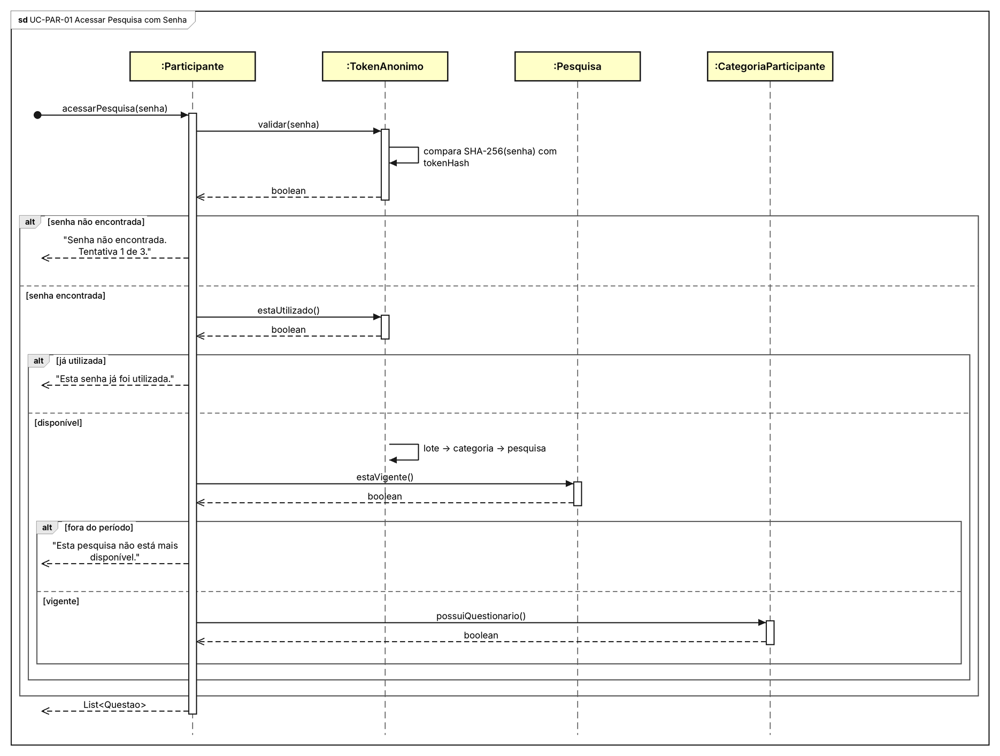

| Item | Descrição |
|---|---|
| **Ator** | Participante |
| **Objetivo** | Entrar em uma pesquisa usando a senha anônima recebida e obter as questões da sua categoria |
| **Pré-condições** | Participante possui uma senha gerada pelo Administrador |
| **Participantes do diagrama** | `:Participante`, `:TokenAnonimo`, `:Pesquisa`, `:CategoriaParticipante` |
| **Gatilho** | `acessarPesquisa(senha)` |

**Fluxo principal**

1. O Participante informa a senha.
2. O sistema chama `TokenAnonimo.validar(senha)`, que compara `SHA-256(senha)` com o `tokenHash` e retorna `boolean`.
3. Com a senha encontrada, o sistema chama `estaUtilizado()` e a senha está disponível.
4. O token percorre a cadeia lote → categoria → pesquisa.
5. O sistema chama `Pesquisa.estaVigente()` e a pesquisa está vigente.
6. O sistema chama `CategoriaParticipante.possuiQuestionario()`.
7. O sistema devolve `List<Questao>` ao Participante.

**Fluxos alternativos**

| Condição | Resultado |
|---|---|
| Senha não encontrada | "Senha não encontrada. Tentativa 1 de 3." |
| Senha já utilizada | "Esta senha já foi utilizada." |
| Pesquisa fora do período | "Esta pesquisa não está mais disponível." |

**Pós-condição:** nenhum dado é alterado; o fluxo só consulta.

**Mapeamento para o banco:** `tokens_anonimos` (`token_hash`, `utilizado_em`) → `lotes_senhas` → `categorias_participantes` → `pesquisas` (`status`, `data_inicio`, `data_fim`).

---

## UC-PAR-02 — Responder Questionário

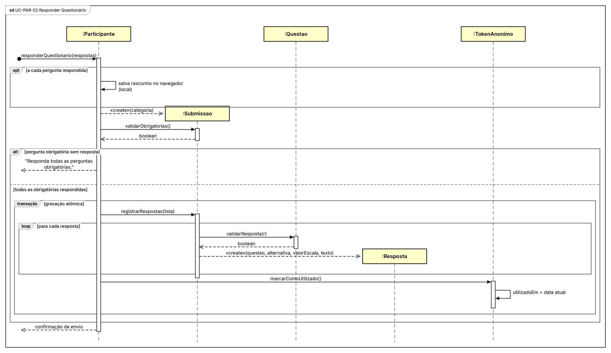

| Item | Descrição |
|---|---|
| **Ator** | Participante |
| **Objetivo** | Enviar as respostas do questionário de forma anônima |
| **Pré-condições** | UC-PAR-01 concluído (senha válida, disponível e pesquisa vigente) |
| **Participantes do diagrama** | `:Participante`, `:Submissao`, `:Questao`, `:Resposta`, `:TokenAnonimo` |
| **Gatilho** | `responderQuestionario(respostas)` |

**Fluxo principal**

1. (Opcional) A cada pergunta respondida, o rascunho é salvo localmente no navegador.
2. O sistema cria a `Submissao` com a categoria.
3. O sistema chama `Submissao.validarObrigatorias()` e todas as obrigatórias foram respondidas.
4. Em uma **transação atômica**:
   1. `Submissao.registrarRespostas(lista)`.
   2. Para cada resposta: `Questao.validarResposta(r)` e criação da `Resposta` (questão, alternativa, valor de escala, texto).
   3. `TokenAnonimo.marcarComoUtilizado()`, com `utilizadoEm` = data atual.
5. O sistema devolve a confirmação de envio.

**Fluxos alternativos**

| Condição | Resultado |
|---|---|
| Pergunta obrigatória sem resposta | "Responda todas as perguntas obrigatórias." |

**Pós-condições:** uma `submissao` e suas `respostas` gravadas; a senha fica marcada como utilizada, sem ligação com a submissão.

**Regras de negócio:** gravação atômica (submissão, respostas e uso da senha juntos); anonimato (a `submissao` não guarda nenhuma referência ao token); `utilizado_em` guarda só a data.

**Mapeamento para o banco:** `submissoes`, `respostas` (trigger `trg_respostas_mesma_categoria` e FK composta com `alternativas`), `tokens_anonimos` (trigger `trg_tokens_uma_utilizacao`).

---

# Administrador

## UC-ADM-01 — Cadastrar Nova Pesquisa

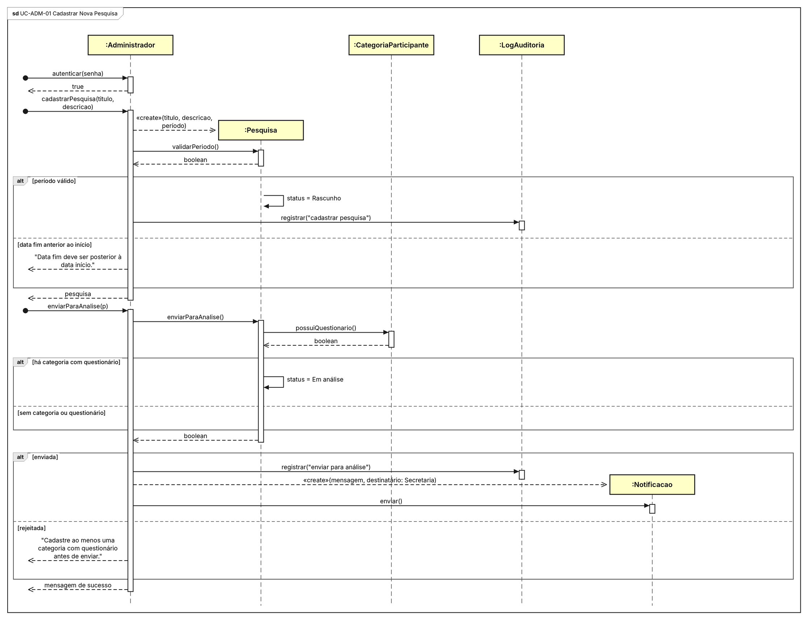

| Item | Descrição |
|---|---|
| **Ator** | Administrador |
| **Objetivo** | Cadastrar uma pesquisa e enviá-la para análise da Secretaria |
| **Pré-condições** | Administrador autenticado |
| **Participantes do diagrama** | `:Administrador`, `:Pesquisa`, `:CategoriaParticipante`, `:LogAuditoria`, `:Notificacao` |
| **Gatilhos** | `cadastrarPesquisa(titulo, descricao)` e `enviarParaAnalise(p)` |

**Fluxo principal**

*Parte A — cadastrar*
1. O Administrador informa título, descrição e período.
2. O sistema cria a `Pesquisa` e chama `validarPeriodo()`.
3. Com o período válido, o status é definido como **Rascunho**.
4. O sistema registra no log "cadastrar pesquisa" e devolve a pesquisa.

*Parte B — enviar para análise*
5. O Administrador aciona `enviarParaAnalise(p)`.
6. `Pesquisa.enviarParaAnalise()` chama `CategoriaParticipante.possuiQuestionario()`.
7. Havendo categoria com questionário, o status passa para **Em análise**.
8. O sistema registra no log "enviar para análise", cria e envia a `Notificacao` ao destinatário Secretaria.
9. O sistema devolve a mensagem de sucesso.

**Fluxos alternativos**

| Condição | Resultado |
|---|---|
| Data fim anterior ao início | "Data fim deve ser posterior à data início." |
| Sem categoria ou questionário | Envio rejeitado: "Cadastre ao menos uma categoria com questionário antes de enviar." |

**Pós-condições:** pesquisa em `RASCUNHO` (parte A) ou `EM_ANALISE` (parte B); log gerado; Secretaria notificada.

**Mapeamento para o banco:** `pesquisas` (`ck_pesquisas_periodo`, `ck_pesquisas_titulo`, `ck_pesquisas_status`), `logs_auditoria`, `notificacoes`.

---

## UC-ADM-02 — Cadastrar Categorias de Participantes

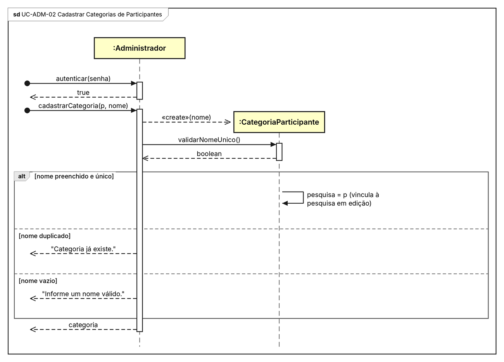

| Item | Descrição |
|---|---|
| **Ator** | Administrador |
| **Objetivo** | Criar uma categoria de participantes dentro de uma pesquisa |
| **Pré-condições** | Administrador autenticado; pesquisa em edição |
| **Participantes do diagrama** | `:Administrador`, `:CategoriaParticipante` |
| **Gatilho** | `cadastrarCategoria(p, nome)` |

**Fluxo principal**

1. O Administrador informa o nome da categoria.
2. O sistema cria a `CategoriaParticipante` e chama `validarNomeUnico()`.
3. Com o nome preenchido e único, a categoria é vinculada à pesquisa em edição.
4. O sistema devolve a categoria.

**Fluxos alternativos**

| Condição | Resultado |
|---|---|
| Nome duplicado | "Categoria já existe." |
| Nome vazio | "Informe um nome válido." |

**Mapeamento para o banco:** `categorias_participantes`; `uq_categorias_pesquisa_nome` garante o nome único dentro da pesquisa.

---

## UC-ADM-03 — Criar Questionário por Categoria

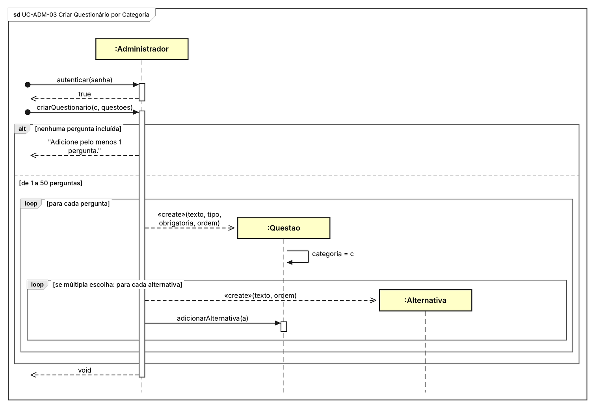

| Item | Descrição |
|---|---|
| **Ator** | Administrador |
| **Objetivo** | Montar o questionário (questões e alternativas) de uma categoria |
| **Pré-condições** | Administrador autenticado; categoria existente |
| **Participantes do diagrama** | `:Administrador`, `:Questao`, `:Alternativa` |
| **Gatilho** | `criarQuestionario(c, questoes)` |

**Fluxo principal**

1. O Administrador envia a lista de questões (de 1 a 50).
2. Para cada questão, o sistema cria a `Questao` (texto, tipo, obrigatória, ordem) e a vincula à categoria.
3. Se a questão for de múltipla escolha, para cada alternativa o sistema cria a `Alternativa` (texto, ordem) e chama `adicionarAlternativa(a)`.
4. O sistema encerra com retorno `void`.

**Fluxos alternativos**

| Condição | Resultado |
|---|---|
| Nenhuma pergunta incluída | "Adicione pelo menos 1 pergunta." |

**Regras de negócio:** mínimo de 1 e máximo de 50 questões por questionário; tipos: múltipla única, múltipla várias, escala e aberta.

**Mapeamento para o banco:** `questoes` (`ck_questoes_tipo`, `ck_questoes_ordem`), `alternativas` (`ck_alternativas_ordem`). O limite de 50 não existe no banco e fica na aplicação.

---

## UC-ADM-04 — Gerar Lote de Senhas Anônimas

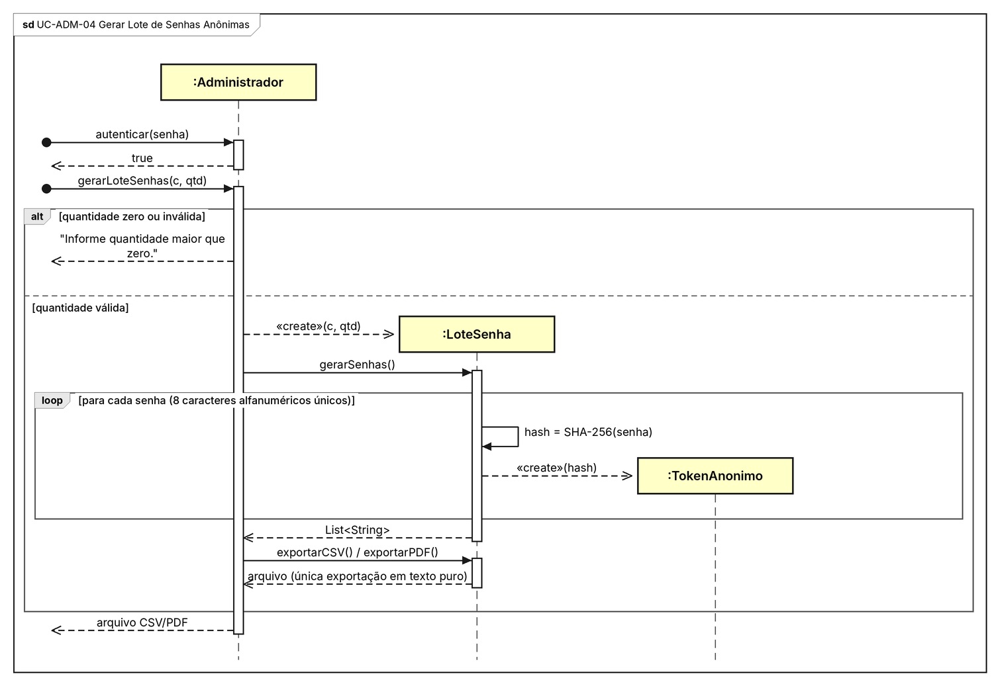

| Item | Descrição |
|---|---|
| **Ator** | Administrador |
| **Objetivo** | Gerar as senhas anônimas de uma categoria e exportá-las |
| **Pré-condições** | Administrador autenticado; categoria existente |
| **Participantes do diagrama** | `:Administrador`, `:LoteSenha`, `:TokenAnonimo` |
| **Gatilho** | `gerarLoteSenhas(c, qtd)` |

**Fluxo principal**

1. O Administrador informa a categoria e a quantidade.
2. O sistema cria o `LoteSenha` e chama `gerarSenhas()`.
3. Para cada senha (8 caracteres alfanuméricos únicos): calcula `hash = SHA-256(senha)` e cria o `TokenAnonimo` com o hash.
4. `gerarSenhas()` devolve `List<String>` com as senhas em texto.
5. O Administrador aciona `exportarCSV()` ou `exportarPDF()`.
6. O sistema devolve o arquivo CSV/PDF. Esta é a **única exportação das senhas em texto puro**.

**Fluxos alternativos**

| Condição | Resultado |
|---|---|
| Quantidade zero ou inválida | "Informe quantidade maior que zero." |

**Regras de negócio:** só o hash é gravado; a senha em texto existe apenas nesta exportação.

**Mapeamento para o banco:** `lotes_senhas` (`ck_lotes_quantidade`), `tokens_anonimos` (`uq_tokens_hash`). Pela regra da aplicação, o lote só é gerado para pesquisa `APROVADA`, e lote e tokens são gravados na mesma transação.

---

## UC-ADM-05 — Gerar Relatório de Resultados

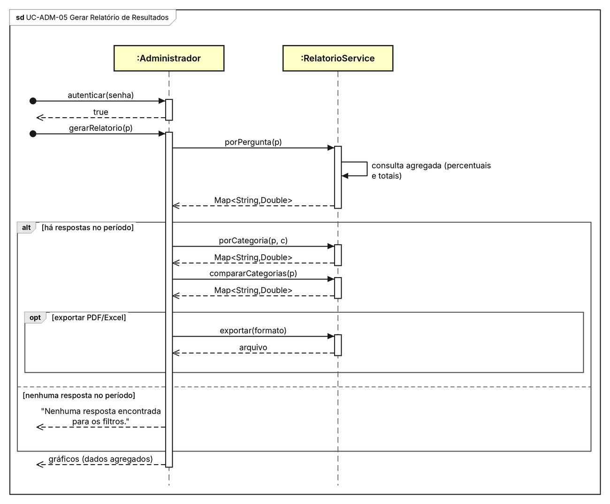

| Item | Descrição |
|---|---|
| **Ator** | Administrador |
| **Objetivo** | Consultar e exportar os resultados agregados de uma pesquisa |
| **Pré-condições** | Administrador autenticado; pesquisa com respostas |
| **Participantes do diagrama** | `:Administrador`, `:RelatorioService` |
| **Gatilho** | `gerarRelatorio(p)` |

**Fluxo principal**

1. O sistema chama `porPergunta(p)`; o serviço faz a consulta agregada (percentuais e totais) e devolve `Map<String,Double>`.
2. Havendo respostas no período, o sistema chama `porCategoria(p, c)` e `compararCategorias(p)`.
3. (Opcional) O Administrador pede a exportação em PDF/Excel: `exportar(formato)` devolve o arquivo.
4. O sistema devolve os gráficos (dados agregados).

**Fluxos alternativos**

| Condição | Resultado |
|---|---|
| Nenhuma resposta no período | "Nenhuma resposta encontrada para os filtros." |

**Mapeamento para o banco:** consulta agregada sobre `respostas`, `submissoes` e `alternativas`; nada é gravado.

---

## UC-ADM-06 — Gerenciar Usuários e Perfis

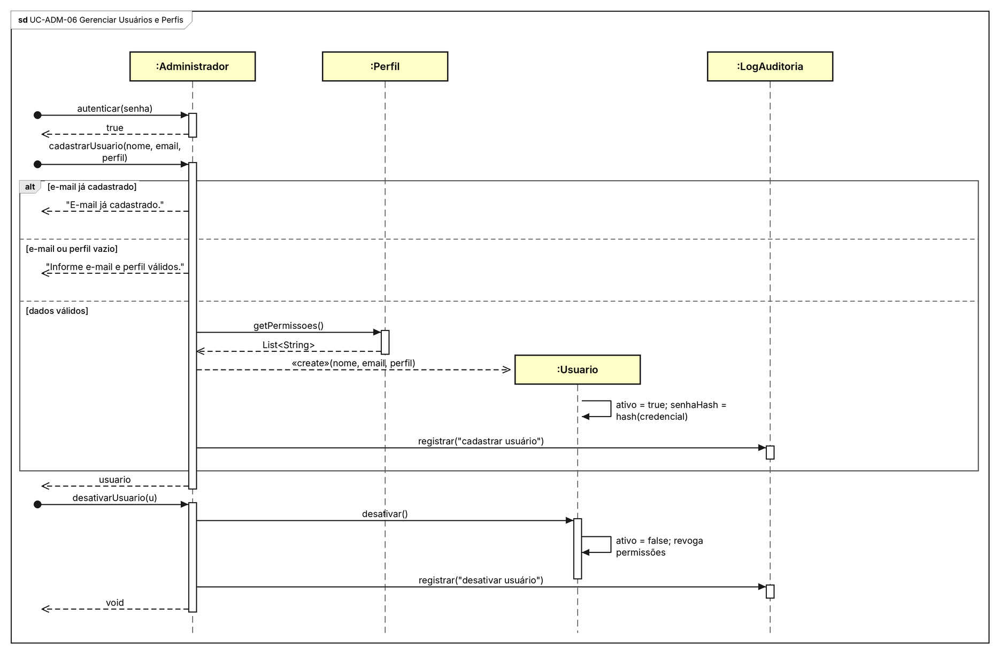

| Item | Descrição |
|---|---|
| **Ator** | Administrador |
| **Objetivo** | Cadastrar usuários internos com um perfil e desativá-los |
| **Pré-condições** | Administrador autenticado |
| **Participantes do diagrama** | `:Administrador`, `:Perfil`, `:Usuario`, `:LogAuditoria` |
| **Gatilhos** | `cadastrarUsuario(nome, email, perfil)` e `desativarUsuario(u)` |

**Fluxo principal**

*Parte A — cadastrar*
1. O Administrador informa nome, e-mail e perfil.
2. Com os dados válidos, o sistema consulta `Perfil.getPermissoes()`.
3. O sistema cria o `Usuario` com `ativo = true` e `senhaHash = hash(credencial)`.
4. O sistema registra no log "cadastrar usuário" e devolve o usuário.

*Parte B — desativar*
5. O Administrador aciona `desativarUsuario(u)`.
6. `Usuario.desativar()` define `ativo = false` e revoga as permissões.
7. O sistema registra no log "desativar usuário" e encerra com `void`.

**Fluxos alternativos**

| Condição | Resultado |
|---|---|
| E-mail já cadastrado | "E-mail já cadastrado." |
| E-mail ou perfil vazio | "Informe e-mail e perfil válidos." |

**Mapeamento para o banco:** `usuarios` (`uq_usuarios_email`, `ativo`, `senha_hash`), `perfis`, `logs_auditoria`. Não há exclusão de usuário: a desativação é a forma de revogar o acesso.

---

## UC-ADM-07 — Monitorar Participação (Dashboard)

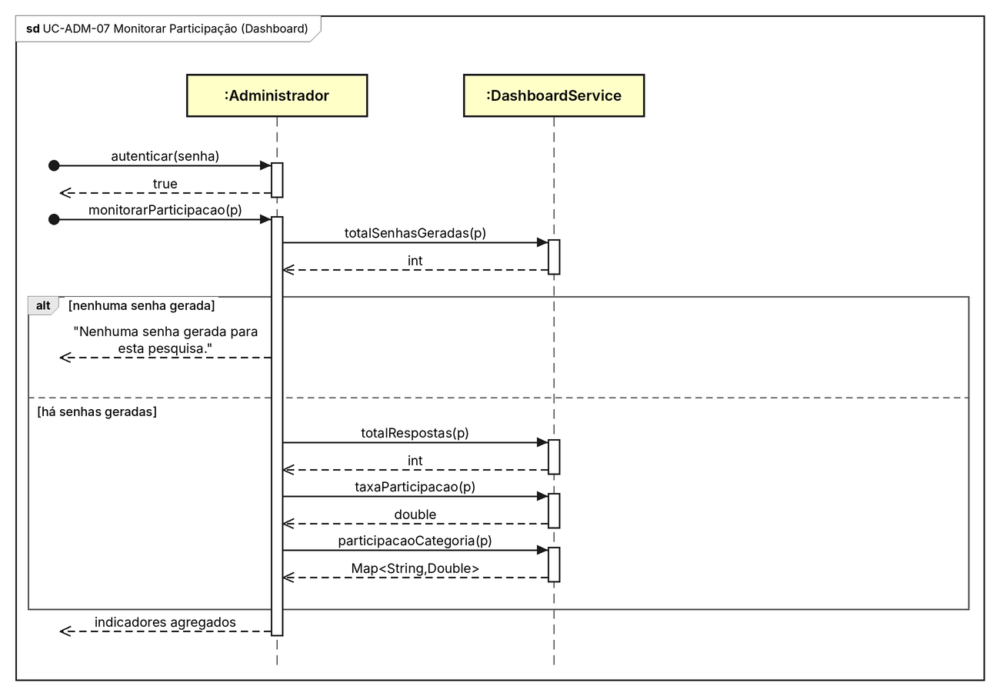

| Item | Descrição |
|---|---|
| **Ator** | Administrador |
| **Objetivo** | Acompanhar os indicadores de participação de uma pesquisa |
| **Pré-condições** | Administrador autenticado |
| **Participantes do diagrama** | `:Administrador`, `:DashboardService` |
| **Gatilho** | `monitorarParticipacao(p)` |

**Fluxo principal**

1. O sistema chama `totalSenhasGeradas(p)` e há senhas geradas.
2. O sistema chama `totalRespostas(p)`, `taxaParticipacao(p)` e `participacaoCategoria(p)`.
3. O sistema devolve os indicadores agregados.

**Fluxos alternativos**

| Condição | Resultado |
|---|---|
| Nenhuma senha gerada | "Nenhuma senha gerada para esta pesquisa." |

**Mapeamento para o banco:** total de senhas = soma de `lotes_senhas.quantidade` ou contagem de `tokens_anonimos`; respostas = `submissoes`. A taxa de participação é calculada pela aplicação.

---

# Secretaria

## UC-SEC-01 — Aprovar Pesquisa antes da Aplicação

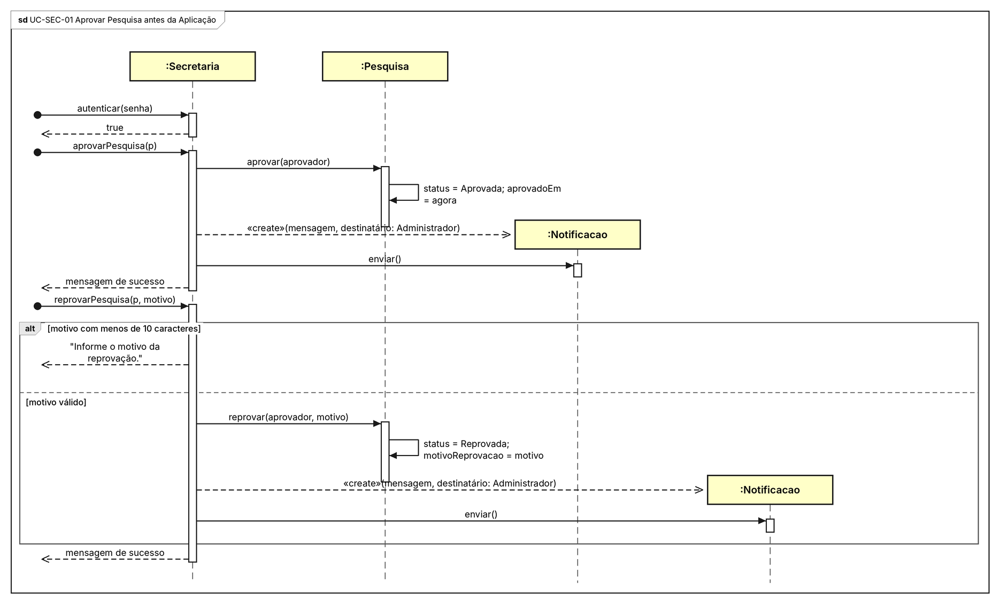

| Item | Descrição |
|---|---|
| **Ator** | Secretaria |
| **Objetivo** | Aprovar ou reprovar uma pesquisa enviada para análise |
| **Pré-condições** | Secretaria autenticada; pesquisa em "Em análise" |
| **Participantes do diagrama** | `:Secretaria`, `:Pesquisa`, `:Notificacao` |
| **Gatilhos** | `aprovarPesquisa(p)` e `reprovarPesquisa(p, motivo)` |

**Fluxo principal — aprovar**

1. A Secretaria aciona `aprovarPesquisa(p)`.
2. `Pesquisa.aprovar(aprovador)` define `status = Aprovada` e `aprovadoEm = agora`.
3. O sistema cria e envia a `Notificacao` ao Administrador.
4. O sistema devolve a mensagem de sucesso.

**Fluxo principal — reprovar**

1. A Secretaria aciona `reprovarPesquisa(p, motivo)` com um motivo válido.
2. `Pesquisa.reprovar(aprovador, motivo)` define `status = Reprovada` e `motivoReprovacao = motivo`.
3. O sistema cria e envia a `Notificacao` ao Administrador.
4. O sistema devolve a mensagem de sucesso.

**Fluxos alternativos**

| Condição | Resultado |
|---|---|
| Motivo com menos de 10 caracteres | "Informe o motivo da reprovação." |

**Mapeamento para o banco:** `pesquisas` (`status`, `aprovado_por`, `aprovado_em`, `motivo_reprovacao`), `notificacoes`.

---

## UC-SEC-02 — Analisar Relatórios Institucionais

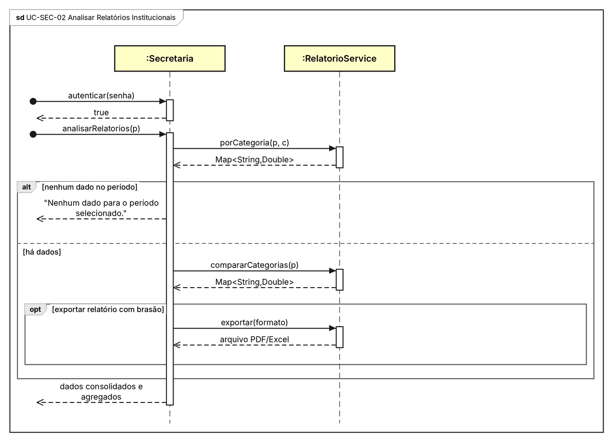

| Item | Descrição |
|---|---|
| **Ator** | Secretaria |
| **Objetivo** | Analisar dados consolidados e comparar categorias |
| **Pré-condições** | Secretaria autenticada |
| **Participantes do diagrama** | `:Secretaria`, `:RelatorioService` |
| **Gatilho** | `analisarRelatorios(p)` |

**Fluxo principal**

1. O sistema chama `porCategoria(p, c)`.
2. Havendo dados, o sistema chama `compararCategorias(p)`.
3. (Opcional) A Secretaria exporta o relatório com brasão: `exportar(formato)` devolve PDF/Excel.
4. O sistema devolve os dados consolidados e agregados.

**Fluxos alternativos**

| Condição | Resultado |
|---|---|
| Nenhum dado no período | "Nenhum dado para o período selecionado." |

**Mapeamento para o banco:** consulta agregada; nada é gravado.

---

# Analista de Dados

## UC-ANA-01 — Analisar Resultados Detalhados

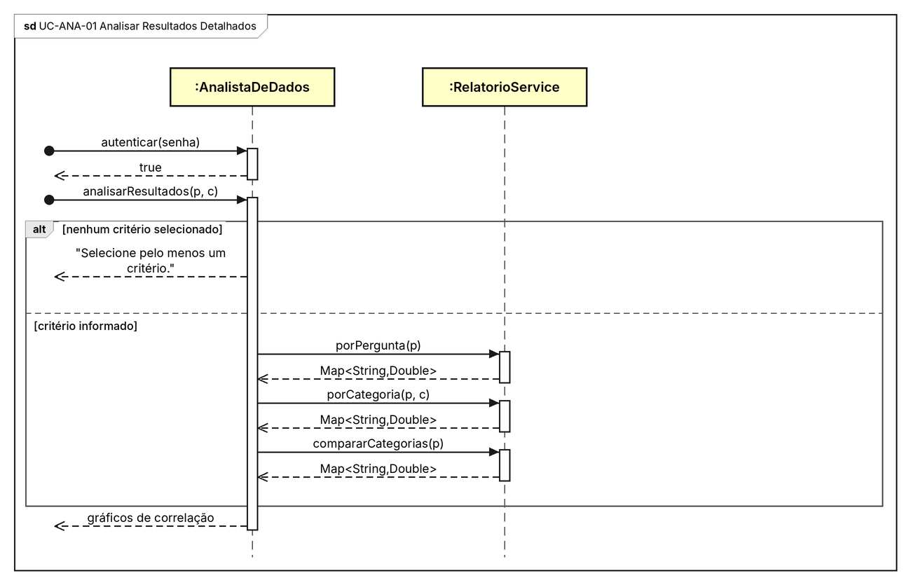

| Item | Descrição |
|---|---|
| **Ator** | Analista de Dados |
| **Objetivo** | Cruzar os resultados por pergunta e categoria |
| **Pré-condições** | Analista autenticado |
| **Participantes do diagrama** | `:AnalistaDeDados`, `:RelatorioService` |
| **Gatilho** | `analisarResultados(p, c)` |

**Fluxo principal**

1. O Analista informa pelo menos um critério.
2. O sistema chama `porPergunta(p)`, `porCategoria(p, c)` e `compararCategorias(p)`.
3. O sistema devolve os gráficos de correlação.

**Fluxos alternativos**

| Condição | Resultado |
|---|---|
| Nenhum critério selecionado | "Selecione pelo menos um critério." |

**Mapeamento para o banco:** consulta agregada sobre `respostas` e `submissoes`.

---

## UC-ANA-02 — Gerar Insights e Exportar Dados

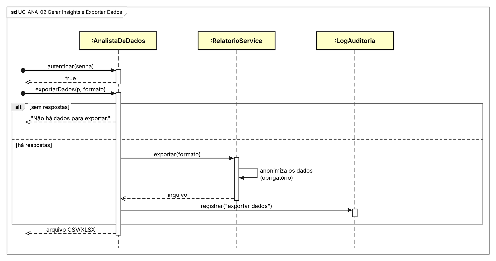

| Item | Descrição |
|---|---|
| **Ator** | Analista de Dados |
| **Objetivo** | Exportar os dados da pesquisa para uso externo |
| **Pré-condições** | Analista autenticado; pesquisa com respostas |
| **Participantes do diagrama** | `:AnalistaDeDados`, `:RelatorioService`, `:LogAuditoria` |
| **Gatilho** | `exportarDados(p, formato)` |

**Fluxo principal**

1. O sistema chama `RelatorioService.exportar(formato)`.
2. O serviço **anonimiza os dados** (obrigatório) e devolve o arquivo.
3. O sistema registra no log "exportar dados".
4. O sistema devolve o arquivo CSV/XLSX.

**Fluxos alternativos**

| Condição | Resultado |
|---|---|
| Sem respostas | "Não há dados para exportar." |

**Regras de negócio:** toda exportação passa por anonimização e deixa registro em `logs_auditoria`.

---

# Auditor

## UC-AUD-01 — Auditar os Dados Coletados

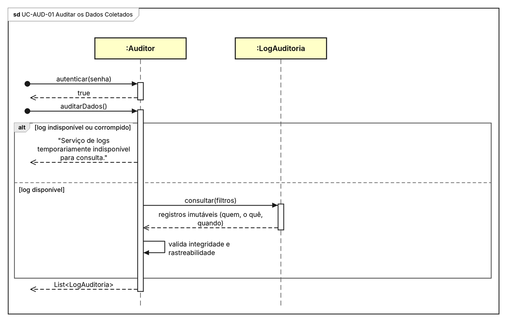

| Item | Descrição |
|---|---|
| **Ator** | Auditor |
| **Objetivo** | Consultar os registros de auditoria e validar integridade e rastreabilidade |
| **Pré-condições** | Auditor autenticado |
| **Participantes do diagrama** | `:Auditor`, `:LogAuditoria` |
| **Gatilho** | `auditarDados()` |

**Fluxo principal**

1. O sistema chama `LogAuditoria.consultar(filtros)`.
2. O log devolve os registros imutáveis (quem, o quê, quando).
3. O Auditor valida integridade e rastreabilidade.
4. O sistema devolve `List<LogAuditoria>`.

**Fluxos alternativos**

| Condição | Resultado |
|---|---|
| Log indisponível ou corrompido | "Serviço de logs temporariamente indisponível para consulta." |

**Mapeamento para o banco:** `logs_auditoria`; os triggers `trg_logs_bloqueia_update` e `trg_logs_bloqueia_delete` garantem a imutabilidade (RNF29).

---

## UC-AUD-02 — Verificar Segurança e Conformidade

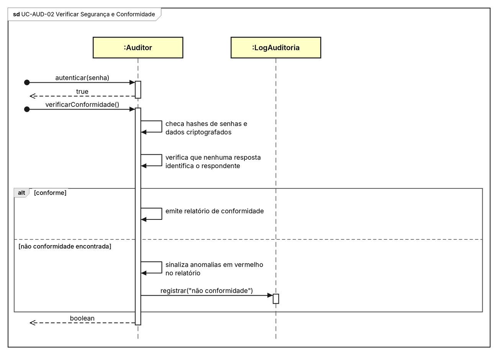

| Item | Descrição |
|---|---|
| **Ator** | Auditor |
| **Objetivo** | Verificar a conformidade do sistema (segurança e LGPD) |
| **Pré-condições** | Auditor autenticado |
| **Participantes do diagrama** | `:Auditor`, `:LogAuditoria` |
| **Gatilho** | `verificarConformidade()` |

**Fluxo principal**

1. O Auditor checa os hashes de senhas e os dados criptografados.
2. O Auditor verifica que nenhuma resposta identifica o respondente.
3. Estando conforme, o sistema emite o relatório de conformidade.
4. O sistema devolve `boolean`.

**Fluxos alternativos**

| Condição | Resultado |
|---|---|
| Não conformidade encontrada | Anomalias sinalizadas em vermelho no relatório; registro no log "não conformidade" |

**Mapeamento para o banco:** `usuarios.senha_hash`, `tokens_anonimos.token_hash`, ausência de vínculo entre `submissoes`/`respostas` e `tokens_anonimos`, `logs_auditoria`.

---

# Suporte Técnico

## UC-SUP-01 — Manter Sistema em Operação

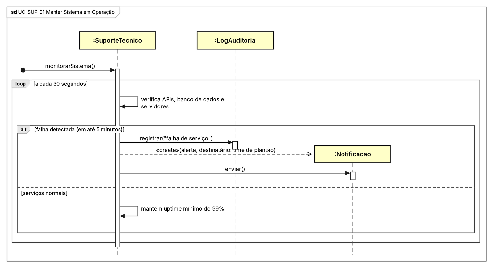

| Item | Descrição |
|---|---|
| **Ator** | Suporte Técnico |
| **Objetivo** | Monitorar continuamente os serviços e alertar em caso de falha |
| **Pré-condições** | Monitoramento em execução |
| **Participantes do diagrama** | `:SuporteTecnico`, `:LogAuditoria`, `:Notificacao` |
| **Gatilho** | `monitorarSistema()` |

**Fluxo principal**

1. O sistema entra em um laço que se repete **a cada 30 segundos**.
2. A cada ciclo, verifica APIs, banco de dados e servidores.
3. Com os serviços normais, o sistema mantém o uptime mínimo de 99%.

**Fluxos alternativos**

| Condição | Resultado |
|---|---|
| Falha detectada (em até 5 minutos) | Registro no log "falha de serviço"; criação e envio de `Notificacao` de alerta ao time de plantão |

**Regras de negócio:** verificação a cada 30 s; falha detectada em até 5 min; uptime mínimo de 99%.

**Mapeamento para o banco:** `logs_auditoria` (`usuario_id` nulo = ação do sistema), `notificacoes`.

---

## UC-SUP-02 — Resolver Erros e Falhas

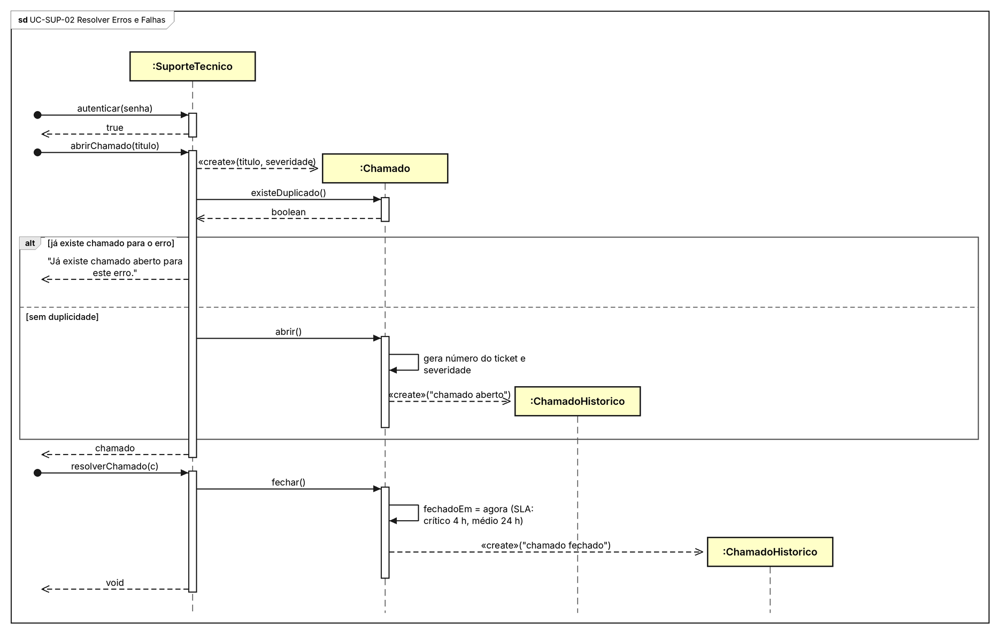

| Item | Descrição |
|---|---|
| **Ator** | Suporte Técnico |
| **Objetivo** | Abrir um chamado para um erro e fechá-lo quando resolvido |
| **Pré-condições** | Suporte Técnico autenticado |
| **Participantes do diagrama** | `:SuporteTecnico`, `:Chamado`, `:ChamadoHistorico` |
| **Gatilhos** | `abrirChamado(titulo)` e `resolverChamado(c)` |

**Fluxo principal**

*Parte A — abrir*
1. O Suporte informa título e severidade.
2. O sistema cria o `Chamado` e chama `existeDuplicado()`; não há duplicidade.
3. `Chamado.abrir()` gera o número do ticket e a severidade.
4. O sistema cria o `ChamadoHistorico` "chamado aberto" e devolve o chamado.

*Parte B — resolver*
5. O Suporte aciona `resolverChamado(c)`.
6. `Chamado.fechar()` define `fechadoEm = agora` (SLA: crítico 4 h, médio 24 h).
7. O sistema cria o `ChamadoHistorico` "chamado fechado" e encerra com `void`.

**Fluxos alternativos**

| Condição | Resultado |
|---|---|
| Já existe chamado para o erro | "Já existe chamado aberto para este erro." |

**Mapeamento para o banco:** `chamados` (`severidade`: `CRITICA`/`MEDIA`/`BAIXA`; `status`: `ABERTO`/`FECHADO`; `aberto_em`; `fechado_em`), `chamados_historico`.

---

# Pontos de atenção entre diagramas e banco

Divergências que vale resolver ou justificar antes da entrega.

| # | Diagrama | Ponto | Sugestão |
|---|---|---|---|
| 1 | UC-PAR-02 | A `Submissao` é criada antes da validação das obrigatórias e fora da transação; se o participante errar, a submissão já existiria | Criar a `Submissao` dentro da transação, depois de `validarObrigatorias()` |
| 2 | UC-PAR-01 | "Tentativa 1 de 3" pressupõe controle de tentativas, que não existe no banco | Informar que o controle é da aplicação (sessão ou IP), ou remover o contador da mensagem |
| 3 | UC-ADM-04 | Não mostra a verificação de que a pesquisa está `APROVADA` | Incluir essa checagem (regra do script) |
| 4 | UC-ADM-03 | Limite de 50 questões não existe no banco | Manter como regra da aplicação |
| 5 | UC-ADM-01 | Título de 5 a 100 caracteres (`ck_pesquisas_titulo`) não aparece nas validações | Incluir como validação do cadastro |
| 6 | UC-SEC-01 | Motivo mínimo de 10 caracteres é regra da aplicação; o banco só tem `motivo_reprovacao TEXT` | Manter na aplicação |
| 7 | UC-SEC-01 / UC-ADM-01 | `notificacoes` tem um único destinatário (`usuario_id`); "destinatário: Secretaria" e "time de plantão" são grupos | Criar uma notificação por usuário do perfil |
| 8 | UC-SUP-02 | SLA (4 h / 24 h) e "número do ticket" não têm campo próprio; o ticket é o `id` e o prazo seria calculado a partir de `aberto_em` e `severidade` | Registrar como regra da aplicação, ou criar uma coluna de prazo |
| 9 | UC-SUP-02 | `existeDuplicado()` não tem restrição no banco | Manter como validação da aplicação |
| 10 | UC-SUP-01 | Status e uptime dos serviços não têm tabela (a tabela `servico` do modelo anterior não existe mais) | Manter em log e monitoramento externo |
| 11 | UC-ANA-02 / UC-ADM-05 | O registro da exportação é gravado só como linha em `logs_auditoria` (a tabela `exportacao` não existe mais) | Registrar formato e pesquisa em `descricao` |
| 12 | UC-AUD-02 | "Dados criptografados" não aparece no banco; só há hashes (`senha_hash`, `token_hash`) | Esclarecer o que é criptografado (ex.: disco ou conexão) |
